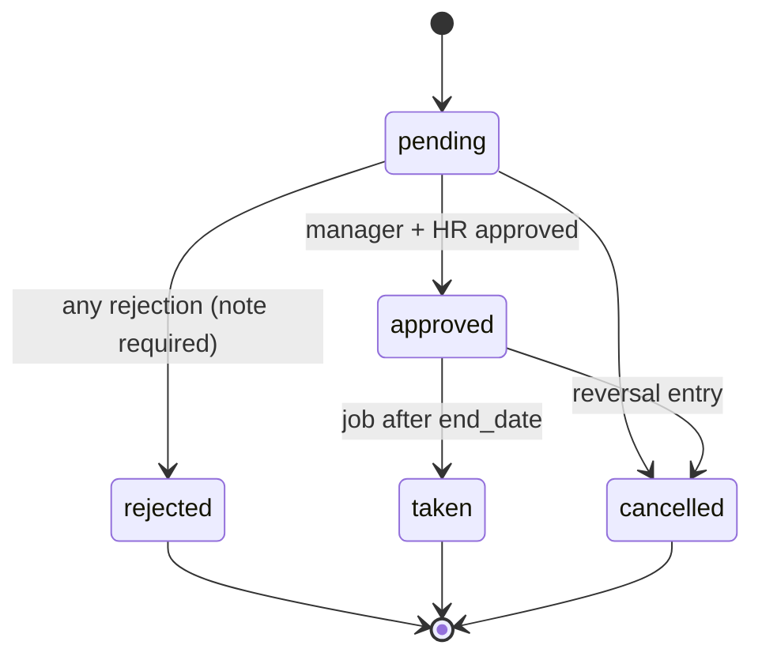

# 03 — Domain analysis

Entities, enums, state machines, workflows and relationships. Field-level detail is in 05-database-design.md. Source: SPEC §5–§7.

## 1. Bounded contexts (modules)

| Module | Aggregates / entities |
|---|---|
| Identity | User, Role, Permission, Ban |
| MasterData | Country, CountryLeavePolicy, LeaveType, BankHoliday, Department, Technology, PaymentPlan, Label, Setting |
| People | EmployeeProfile, EmergencyContact, TechnologyUser, Salary, Offboarding, Performance |
| Clients | Customer, ClientTechnologyRate, Project, ProjectTechnology, ProjectUser, FixedCost |
| Work | Task, Log, TimesheetLock |
| Leave | LeaveRequest, LeaveRequestApproval, LeaveLedgerEntry |
| Expenses `[OPTIONAL]` | Expense, ExpenseLine |
| Audit | Activity (spatie) |

## 2. Aggregate roots and invariants

| Root | Invariants |
|---|---|
| User | Exactly one role (D-09). `manager_id` is another user, no cycles `[DERIVED]`. Salary and leave balance are not columns (D-03). |
| Customer | `currency_code` fixed once rates or logs exist (D-18). Deactivated → no new projects/tasks/logs (BR-31). |
| Project | Manager has role admin (BR-30). Technologies ⊆ client's rated technologies (BR-10). `estimated_hours`, `budget_minor` computed (BR-13). No priority (D-02). |
| Task | Technology ∈ project technologies (BR-10). One nullable assignee (BR-09). Parent in same project, acyclic (BR-11). |
| Log | Exactly one of task-log or direct-log shape (BR-02). Duration > 0; daily total ≤ 24 h (BR-04). Rate snapshot immutable (BR-06). Month lock (BR-07). |
| LeaveRequest | Server-computed `days_requested` (BR-16). No overlap with other active requests (BR-23). Balance check (BR-24). Status machine (BR-19). |
| LeaveLedger | Append-only; balance = Σ non-expired `days`. |
| Salary | Append-only (BR-29). |
| Offboarding | One non-cancelled per user. |

## 3. Enumerations (PHP backed string enums, D-19)

| Enum | Values |
|---|---|
| `Role` (names only, never used for checks) | superadmin, admin, hr, assistant, employee |
| `EmploymentType` | full_time, part_time, contractor, freelance, intern |
| `Gender` | male, female, other, undisclosed |
| `MaritalStatus` | single, married, divorced, widowed, other |
| `Priority` (customer, task) | low, medium, high, critical |
| `ProjectType` | standalone, recurring, pay_as_you_go |
| `ProjectStatus` | planning, active, on_hold, completed, cancelled |
| `TaskStatus` | backlog, todo, in_progress, in_review, completed, cancelled |
| `LogType` | normal_hours, extra_hours, replacement_hours, others |
| `LeaveStatus` | pending, approved, rejected, taken, cancelled |
| `DayPart` | full, am, pm |
| `ApprovalStage` | manager, hr |
| `ApprovalDecision` | approved, rejected |
| `LedgerEntryType` | grant, adjustment, carry_over, deduction, reversal, expiry |
| `Proration` | none, by_start_date |
| `PaymentPlanType` | days_after_invoice, end_of_month, prepayment |
| `SalaryStatus` | pending, active, superseded |
| `OffboardingStatus` | pending, in_progress, completed, cancelled |
| `ExpenseCategory` `[OPTIONAL]` | travel, meals, supplies, equipment, software, other |
| `ExpenseStatus` `[OPTIONAL]` | draft, submitted, approved, rejected, reimbursed |

Lookup tables (extensible, seeded): `leave_types` (annual_leave, sick_leave, personal_leave, unpaid_leave, parental_leave), `labels` (Bug, Feature, Design, Testing, Refactoring, Enhancement, Documentation). Source of hire is a free string.

## 4. State machines

**Leave request (BR-19, D-07)**

Direct day off (BR-22) is created directly in `approved`.

**Task:** backlog → todo → in_progress → in_review → completed; any → cancelled. SPEC defines no transition restrictions; none are enforced `[ASSUMED]` (ADR if the owner wants a stricter flow).

**Offboarding:** pending → in_progress → completed | cancelled. `completed` bans the user (ADR-0008) and starts the anonymisation clock (BR-28).

**Salary:** pending → active → superseded. Append-only; activating a new row supersedes the previous active one `[ASSUMED D-19]`.

**Expense `[OPTIONAL]`:** draft → submitted → approved|rejected; approved → reimbursed.

## 5. Computation rules

- **Rate for date:** latest `client_technology_rates` row with `effective_from <= date` for (customer, technology).
- **Budget (D-04):** `Σ(estimated_hours × rate at project.start_date) + Σ fixed_costs`; integer minor units, client currency. Hours × rate rounds half-up to the minor unit per technology line `[ASSUMED]`.
- **Leave days (BR-16/17):** iterate dates; skip country's non-working weekdays and country bank holidays; first/last day parts contribute 0.5; single-day carries one part.
- **Proration (BR-18):** `days_per_year × remaining_days_in_year / days_in_year`, rounded to nearest 0.5 `[ASSUMED D-08]`.
- **Balance:** Σ ledger `days` where not expired; available = balance − Σ pending request days.

## 6. Relationships

See SPEC §5.8 (unchanged). ERD in 05-database-design.md.

## 7. Workflows → modules

| Workflow | Modules |
|---|---|
| W-01 onboarding | Identity, MasterData, People, Leave (grant) |
| W-02 client and project setup | Clients |
| W-03 task and logging | Work, Clients |
| W-04 direct logging | Work, Clients |
| W-05 leave request | Leave, MasterData |
| W-06 direct day off | Leave |
| W-07 holidays | MasterData |
| W-08 month close | Work |
| W-09 performance review | People |
| W-10 offboarding | People, Identity |

## Open questions for the owner

1. Should task status transitions be restricted (e.g. no jump from backlog to completed)?
2. Should the budget rounding rule (half-up per technology line) be confirmed?
3. Does a user's `manager_id` chain need a depth limit or must it be acyclic only?
