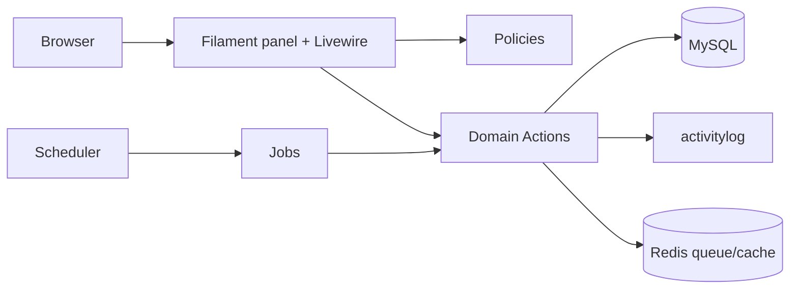

# 04 — Architecture

## 1. Decision

**Modular monolith** `[ASSUMED]`, one Laravel app, one Filament panel for all roles (D-16, ADR-0001, ADR-0002). No microservices: single team, single database, tight transactional rules (leave ledger, rate snapshot, month lock) that benefit from one transaction boundary.

## 2. Stack (verified 2026-11-11, see §6)

Laravel 13 (`laravel/laravel` v13.11.0, needs PHP ^8.3), PHP 8.4+ (required by `spatie/laravel-activitylog` 5), Filament 5.11 (Livewire 4, Tailwind, Alpine), MySQL 8.4 (InnoDB, utf8mb4, strict), Redis (cache, queue, session), Supervisor. Local PHP is 8.5.12 under Herd.

## 3. Module layout

```
app/
  Domain/
    Identity/    Actions, Policies, Enums, Models
    MasterData/
    People/
    Clients/
    Work/
    Leave/
    Expenses/    [OPTIONAL]
    Shared/      Money, Minutes, DateRange value objects; Contracts
  Filament/
    Resources/   one folder per module
    Pages/       MyDay, LeaveCalendar, MyLeave
  Jobs/ Console/ Providers/
database/{migrations,seeders,factories}
tests/{Unit,Feature,Architecture,Performance}
```

Rules:
- Models carry relations, casts and scopes only. Business rules live in **Actions** (`LogTime`, `RequestLeave`, `DecideLeave`, `ComputeProjectBudget`, `ApplyAnnualGrant`, `AnonymizeUser`) invoked by Filament pages, jobs and tests alike.
- A module may call another's Actions or read its models; it may not write another module's tables directly.
- Filament resources are thin: forms/tables plus Policy-gated actions.
- Pest architecture tests enforce: no `hasRole(` in `app/`, Domain does not import `App\Filament`, no `float` money.

## 4. Cross-cutting

| Concern | Approach |
|---|---|
| AuthZ | `spatie/laravel-permission`; Policies per model check permission strings; relationship rules (own, direct manager, project member) layered inside Policies. Seeder assigns every superadmin permission explicitly. |
| Audit | `spatie/laravel-activitylog` via a shared `LogsBusinessActivity` trait; logs attributes before/after; scrubber hook for anonymisation. |
| Money | `Money` value object (minor int + ISO currency); casts on models. |
| Time | UTC storage; `CountryClock` helper converts to country timezone for date logic (BR-34). |
| Settings | `spatie/laravel-settings` classes `LeaveSettings` (carry-over), `PrivacySettings` (`anonymize_after_months`). |
| Config isolation | `[ASSUMED D-xx]` items sit behind config/enums/policies: `config/task-logger.php` (rounding, defaults), enums, single-purpose classes. |

## 5. Runtime

- **Queue:** Redis; Supervisor-run `queue:work` (Horizon not in SPEC; adopt only by ADR). Exports (BR-33) queued.
- **Scheduler:** one cron `schedule:run`, jobs: `ApplyAnnualGrant` (1 Jan per country timezone, hourly check, idempotent), `MarkLeaveTaken` (daily), `AnonymizeOffboardedUsers` (daily), `PruneActivityLog` not scheduled (audit is retained).
- **Filament panel:** single panel `/app`; navigation groups by module; custom pages My Day, Leave Calendar, My Leave.



## 6. Package verification (Packagist, 2026-11-11)

| SPEC name | Verified package | Latest stable | PHP / Laravel constraint | Verdict |
|---|---|---|---|---|
| Laravel | `laravel/laravel` | v13.11.0 | php ^8.3, framework ^13.17 | Use |
| Filament | `filament/filament` | v5.11.2 | php ^8.2; support allows illuminate ^11.28\|^12\|^13, Livewire ^4.4.8 | Use |
| debugbar | `barryvdh/laravel-debugbar` | v4.4.5 | ^11\|^12\|^13 | dev only |
| `404labfr/laravel-impersonate` | **`lab404/laravel-impersonate`** (404labfr does not exist) | 1.7.8 | laravel ^6…^13 | `[OPTIONAL]`, install in M6 |
| ban | `cybercog/laravel-ban` | 4.11.0 | ^9…^13 | Use |
| `nomaduro/larastan` | **`larastan/larastan`** (nomaduro name not on Packagist) | v3.15.0 | ^11.44.2\|^12.4.1\|^13 | dev |
| ide-helper | `barryvdh/laravel-ide-helper` | v3.8.0 | ^11.15\|^12\|^13 | dev |
| phone | `propaganistas/laravel-phone` | 6.1.0 | ^11\|^12\|^13 | Use |
| activitylog | `spatie/laravel-activitylog` | 5.1.4 | **php ^8.4**, ^12\|^13 | Use (forces PHP 8.4+) |
| `spatie/laravel-permissions` | **`spatie/laravel-permission`** | 8.5.0 | php ^8.3, ^12\|^13 | Use |
| sluggable | `spatie/laravel-sluggable` | 4.0.6 | php ^8.3, ^12\|^13 | Use |
| settings | `spatie/laravel-settings` | 3.10.1 | database ^12\|^13 | Use |
| navigation | `spatie/laravel-navigation` | 1.3.0 (last release 2024-09-20) | php ^8.0, no Laravel 13 declaration | **Do not install**; use Filament navigation (ADR-0006) |

Not in SPEC §2.3 and therefore **not** installed: Shield, medialibrary, backup, Horizon, Boost (named by TRD.md). Adopting any needs an ADR/owner approval. Exact installed versions get pinned in `composer.json` at M0 and re-checked then; this table is a snapshot.

## 7. ADR index

0001 modular monolith, 0002 single panel, 0003 SPEC authority, 0004 MCP deferred, 0005 2FA/SSO, 0006 navigation, 0007 manager authority, 0008 offboarding deactivation, 0009 HR record visibility. See `docs/adr/`.

## Open questions for the owner

1. Approve Horizon, Shield, medialibrary or backup packages (TRD.md) or stay with the SPEC list?
2. Confirm PHP 8.4+ as the minimum (forced by activitylog 5).
3. Hosting target (Herd locally; Apache vs Nginx in prod) for the CI/CD doc.

## 8. M0 outcome (installed 2026-11-11)

Pinned by `composer.lock`: laravel/framework 13.42.0, filament/filament 5.11.2, livewire 4.4.8, spatie/laravel-permission 8.5.0, activitylog 5.1.4, sluggable 4.0.6, settings 3.10.1, cybercog/laravel-ban 4.11.0, propaganistas/laravel-phone 6.1.0. Dev: larastan 3.15.0 (phpstan 2.3.5), pest 5.3.5 (phpunit 13.4.5), pint 1.32.3, debugbar 4.4.5, ide-helper 3.8.0. `composer.json` requires PHP ^8.4. `composer audit` is clean.

Deviations from the plan: panel id/path is `app` (`/app`, `AppPanelProvider`); skeleton's PHPUnit 12 pin was replaced because Pest 5 requires PHPUnit 13; the Laravel skeleton's `AGENTS.md`/`CLAUDE.md` boilerplate was not kept; Pint enforces `declare_strict_types` and rewrote the published vendor migrations accordingly. Not installed: spatie/laravel-navigation (ADR-0006), lab404/laravel-impersonate (`[OPTIONAL]`, M6). Tests run against MySQL 8.4 (`task_logger_testing`), not SQLite.
