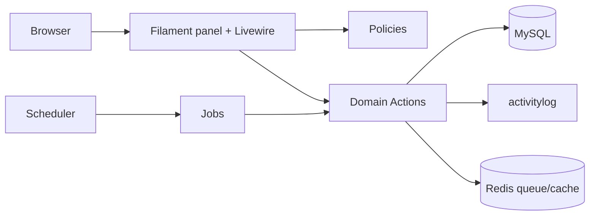

# 04 — Architecture

## 1. Decision

**Modular monolith** `[ASSUMED]`, one Laravel app, one Filament panel for all roles (D-16, ADR-0001, ADR-0002). No microservices: single team, single database, tight transactional rules (leave ledger, rate snapshot, month lock) that benefit from one transaction boundary.

## 2. Stack (verified 2026-11-11, see §6)

Laravel 13 (`laravel/laravel` v13.11.0, needs PHP ^8.3), PHP 8.4+ (required by `spatie/laravel-activitylog` 5), Filament 5.11 (Livewire 4, Tailwind, Alpine), MySQL 8.4 (InnoDB, utf8mb4, strict), Redis (cache, queue, session), Supervisor. Local PHP is 8.5.12 under Herd.

## 3. Module layout

```
app/
  Domain/
    Identity/    Actions, Policies, Enums, Models
    MasterData/
    People/
    Clients/
    Work/
    Leave/
    Expenses/    [OPTIONAL]
    Shared/      Money, Minutes, DateRange value objects; Contracts
  Filament/
    Resources/   one folder per module
    Pages/       MyDay, LeaveCalendar, MyLeave
  Jobs/ Console/ Providers/
database/{migrations,seeders,factories}
tests/{Unit,Feature,Architecture,Performance}
```

Rules:
- Models carry relations, casts and scopes only. Business rules live in **Actions** (`LogTime`, `RequestLeave`, `DecideLeave`, `ComputeProjectBudget`, `ApplyAnnualGrant`, `AnonymizeUser`) invoked by Filament pages, jobs and tests alike.
- A module may call another's Actions or read its models; it may not write another module's tables directly.
- Filament resources are thin: forms/tables plus Policy-gated actions.
- Pest architecture tests enforce: no `hasRole(` in `app/`, Domain does not import `App\Filament`, no `float` money.

## 4. Cross-cutting

| Concern | Approach |
|---|---|
| AuthZ | `spatie/laravel-permission`; Policies per model check permission strings; relationship rules (own, direct manager, project member) layered inside Policies. Seeder assigns every superadmin permission explicitly. |
| Audit | `spatie/laravel-activitylog` via a shared `LogsBusinessActivity` trait; logs attributes before/after; scrubber hook for anonymisation. |
| Money | `Money` value object (minor int + ISO currency); casts on models. |
| Time | UTC storage; `CountryClock` helper converts to country timezone for date logic (BR-34). |
| Settings | `spatie/laravel-settings` classes `LeaveSettings` (carry-over), `PrivacySettings` (`anonymize_after_months`). |
| Config isolation | `[ASSUMED D-xx]` items sit behind config/enums/policies: `config/task-logger.php` (rounding, defaults), enums, single-purpose classes. |

## 5. Runtime

- **Queue:** Redis; Supervisor-run `queue:work` (Horizon not in SPEC; adopt only by ADR). Exports (BR-33) queued.
- **Scheduler:** one cron `schedule:run`, jobs: `ApplyAnnualGrant` (1 Jan per country timezone, hourly check, idempotent), `MarkLeaveTaken` (daily), `AnonymizeOffboardedUsers` (daily), `PruneActivityLog` not scheduled (audit is retained).
- **Filament panel:** single panel `/app`; navigation groups by module; custom pages My Day, Leave Calendar, My Leave.



## 6. Package verification (Packagist, 2026-11-11)

| SPEC name | Verified package | Latest stable | PHP / Laravel constraint | Verdict |
|---|---|---|---|---|
| Laravel | `laravel/laravel` | v13.11.0 | php ^8.3, framework ^13.17 | Use |
| Filament | `filament/filament` | v5.11.2 | php ^8.2; support allows illuminate ^11.28\|^12\|^13, Livewire ^4.4.8 | Use |
| debugbar | `barryvdh/laravel-debugbar` | v4.4.5 | ^11\|^12\|^13 | dev only |
| `404labfr/laravel-impersonate` | **`lab404/laravel-impersonate`** (404labfr does not exist) | 1.7.8 | laravel ^6…^13 | `[OPTIONAL]`, install in M6 |
| ban | `cybercog/laravel-ban` | 4.11.0 | ^9…^13 | Use |
| `nomaduro/larastan` | **`larastan/larastan`** (nomaduro name not on Packagist) | v3.15.0 | ^11.44.2\|^12.4.1\|^13 | dev |
| ide-helper | `barryvdh/laravel-ide-helper` | v3.8.0 | ^11.15\|^12\|^13 | dev |
| phone | `propaganistas/laravel-phone` | 6.1.0 | ^11\|^12\|^13 | Use |
| activitylog | `spatie/laravel-activitylog` | 5.1.4 | **php ^8.4**, ^12\|^13 | Use (forces PHP 8.4+) |
| `spatie/laravel-permissions` | **`spatie/laravel-permission`** | 8.5.0 | php ^8.3, ^12\|^13 | Use |
| sluggable | `spatie/laravel-sluggable` | 4.0.6 | php ^8.3, ^12\|^13 | Use |
| settings | `spatie/laravel-settings` | 3.10.1 | database ^12\|^13 | Use |
| navigation | `spatie/laravel-navigation` | 1.3.0 (last release 2024-09-20) | php ^8.0, no Laravel 13 declaration | **Do not install**; use Filament navigation (ADR-0006) |

Not in SPEC §2.3 and therefore **not** installed: Shield, medialibrary, backup, Horizon, Boost (named by TRD.md). Adopting any needs an ADR/owner approval. Exact installed versions get pinned in `composer.json` at M0 and re-checked then; this table is a snapshot.

## 7. ADR index

0001 modular monolith, 0002 single panel, 0003 SPEC authority, 0004 MCP deferred, 0005 2FA/SSO, 0006 navigation, 0007 manager authority, 0008 offboarding deactivation, 0009 HR record visibility. See `docs/adr/`.

## Open questions for the owner

1. Approve Horizon, Shield, medialibrary or backup packages (TRD.md) or stay with the SPEC list?
2. Confirm PHP 8.4+ as the minimum (forced by activitylog 5).
3. Hosting target (Herd locally; Apache vs Nginx in prod) for the CI/CD doc.

## 8. M0 outcome (installed 2026-11-11)

Pinned by `composer.lock`: laravel/framework 13.42.0, filament/filament 5.11.2, livewire 4.4.8, spatie/laravel-permission 8.5.0, activitylog 5.1.4, sluggable 4.0.6, settings 3.10.1, cybercog/laravel-ban 4.11.0, propaganistas/laravel-phone 6.1.0. Dev: larastan 3.15.0 (phpstan 2.3.5), pest 5.3.5 (phpunit 13.4.5), pint 1.32.3, debugbar 4.4.5, ide-helper 3.8.0. `composer.json` requires PHP ^8.4. `composer audit` is clean.

Deviations from the plan: panel id/path is `app` (`/app`, `AppPanelProvider`); skeleton's PHPUnit 12 pin was replaced because Pest 5 requires PHPUnit 13; the Laravel skeleton's `AGENTS.md`/`CLAUDE.md` boilerplate was not kept; Pint enforces `declare_strict_types` and rewrote the published vendor migrations accordingly. Not installed: spatie/laravel-navigation (ADR-0006), lab404/laravel-impersonate (`[OPTIONAL]`, M6). Tests run against MySQL 8.4 (`task_logger_testing`), not SQLite.

## 9. M1 outcome (2026-11-11)

Built: permission constants (`App\Domain\Identity\Permissions`), the role map in `config/permission.php` validated by `PermissionCatalog`, and the seeder, five roles, `AssignUserRole` (D-09), `Money` value object (BR-12), master data (countries with leave policies, leave types, departments, technologies, payment plans, labels, bank holidays), settings (`PrivacySettings`, `LeaveSettings`), Filament resources and a Settings page, audit on every M1 model.

Deviations and findings:
- **Users table pulled forward from M2.** Departments, countries, roles and the audit tests all need `users`. The full SPEC 5.2 operational columns exist; `country`, `department`, `employment_type` and `start_date` are nullable at the database level so the first superadmin can be seeded, and `CreateUser` (M2) requires them. Profiles, contacts, salaries and skills stay in M2. The model moved to `App\Domain\Identity\Models\User`.
- **Activitylog 5 stores before/after values in `attribute_changes`, not `properties`.** BR-07 (before/after on locked-month edits) and the BR-28 scrub must target `attribute_changes` as well as `properties`. SPEC wording ("properties") is read that way.
- **Permissions deferred:** `employees.impersonate` (M6, optional) and `expenses.*` (M8, optional; SPEC does not name the individual actions). The grid test asserts the seeded set equals the catalog, so adding them later is a deliberate change.
- **Assistant "add" (D-10):** implemented as separate `countries.create`, `departments.create`, `technologies.create` permissions; `.manage` means update and delete. `[ASSUMED]` the assistant may also list those rows (so it can avoid duplicates); nothing else is readable.
- **Leave policies are edited inside the Country form** (repeater, visible only with `country_leave_policies.manage`), as SPEC section 8 says "Countries (with leave policies)". There is no standalone policy resource; `CountryLeavePolicyPolicy` is registered for later use.
- **No country or policy seed data.** SPEC names no day counts; the superadmin enters them. The superadmin account is created only when `SUPERADMIN_EMAIL` and `SUPERADMIN_PASSWORD` are set.
- **Spatie permission hooks in via a Gate `before` callback** that only grants permissions the user holds. It is not a superadmin bypass; the grid test proves this by revoking a permission from the superadmin role and checking it is denied.
- **2FA (ADR-0005):** Filament 5 ships app (TOTP) and email multi-factor authentication, so the proposal is feasible. Not enabled: waiting for D-26.
- `Model::preventLazyLoading()` is on outside production (NFR-09).

### M1 addendum (owner changes after the first M1 report)

- **Permissions are class constants** (`Permissions::LABELS_MANAGE`), modelled on the owner's other project: one `Permissions` class, the role map in `config/permission.php`. Roles stay a `RoleName` enum because they are only assigned, never checked. Policies, resources and tests use the constants; an architecture test fails on any permission string literal in `app/`. A role entry naming a non-constant throws.
- **2FA (ADR-0005, D-26).** New `SecuritySettings` (global on/off, required, grace days, required-since), `TwoFactorPolicy` (grace logic, falls back to config defaults if the settings table is not migrated yet), `EnforceTwoFactorGracePeriod` middleware, the Two-factor authentication page (permission `two_factor.manage`, superadmin only) and a grace-period banner. Filament's profile page and built-in app authentication provide enrolment and the login challenge. New permission `two_factor.manage` brings the grid to 65 permissions.

## 10. M2 outcome (2026-11-12)

Built: employee management (create, edit account, role, skills), private HR record and emergency contacts, salaries (append-only), the public Directory, deactivate and reactivate, 2FA reset, set-password link, locked-down Profile page, Activity Log viewer, daily salary activation job.

- **Two separate surfaces for people (D-14, BR-26).** `DirectoryResource` is built on `App\Domain\People\Support\Directory::query()`, which selects only `id, name, surname, position, department_id, avatar_path` and eager-loads department and technologies. Every directory screen or future export must start from it. `EmployeeResource` is the management surface and is invisible to employee and assistant.
- **Permissions by slice, not by role.** The Edit screen shows tabs by permission and saves each part through its own action, which re-checks its own permission: `UpdateEmployee` needs `employees.update` (superadmin), `UpdateHrRecord` needs `employees.update_hr_record` (superadmin, admin, hr), `RecordSalary` needs `salaries.manage`. An HR user who tampers with account fields changes nothing (tested).
- **Actions record the actor.** Actions that take an `$actor` run inside `CauserResolver::withCauser`, so the audit trail names them even when called from a job or console.
- **Bug found by tests:** `Eloquent\Collection::except()` filters by model primary key, not by the collection key; `SyncSkills` used it by technology id and deleted the wrong rows. Fixed with `reject()`.
- **Money exponent (D-34).** `Money::fractionDigits()` is an ISO 4217 table. ICU gives the Albanian lek 0 decimals.
- **Larastan:** `parseModelCastsMethod: true` in `phpstan.neon`, otherwise date, enum and array casts defined in `casts()` are typed as `string`.
- **Set-password link.** `config/auth.php` password reset `expire` is 4320 minutes (72 hours), which also applies to ordinary resets. Password reset is enabled on the panel.
- **Avatars** are stored on the `public` disk under `avatars/`; run `php artisan storage:link` on each environment.
- **Phones.** Stored as E.164; national format (`0692123456`) is accepted only when the employee has a country (`propaganistas/laravel-phone`).
- **Deferred:** W-01 step 4 (leave grant on the start date) arrives with M5; offboarding-driven deactivation and anonymisation arrive in M6 (the ban action here is reused).

## 11. M3 outcome (2026-11-12)

Built: clients with hourly rate history, projects with technologies, estimates and members, fixed costs, computed budget, tasks with labels, and the Filament screens (Clients, Projects, Tasks, rates tab, fixed costs tab).

- **Budget (D-04, BR-13, BR-14).** `BudgetCalculator` is integer-only: hours in hundredths, rate at the project start date via `ClientRates::forDate()`, half-up rounding per technology line, plus fixed costs. `ComputeProjectBudget` stores the `estimated_hours` and `budget_minor` snapshot and throws when a technology has no rate on the start date, so the surrounding transaction rolls back (D-36). It runs after every change to technologies, estimates, start date, fixed costs and rates.
- **BR-10 is enforced twice.** Actions validate with friendly messages; the database also enforces it with a composite foreign key from `tasks (project_id, technology_id)` to `project_technology`. A technology used by a task cannot be removed from its project.
- **BR-30 (project manager is an admin).** The role literal lives in exactly one file, `ProjectManagerEligibility`, because the rule is about who may be picked, not about access; the architecture test allow-lists only that file. The role-change half goes through a contract (`BlocksRoleChange`, tagged `role-change-guards`) so Identity does not depend on Clients: `AssignUserRole` refuses to move a manager off the admin role.
- **Visibility (D-05).** Rates, the payment plan and the budget need `clients.view_rates`; the Customer and Project screens, lists and infolists hide them, and the tests search the rendered HTML. Employees and HR see only tasks assigned to them; superadmin, admin and assistant see all.
- **Task status (BR-35).** `TaskPolicy::changeStatus`: `tasks.change_status`, or `tasks.change_status_own` for the assignee, or the creator of a task made for someone else (the creator rule still needs `tasks.create`).
- **Audit.** Every M3 model is logged, including the project technology and member rows; label changes on a task are logged as `labels_changed`.
- **UI notes.** Relation managers on View screens are editable for people who may manage them (Filament defaults them to read-only). Filament returns enum-backed selects as enum cases in modals; actions accept both.
- **Test environment.** `phpunit.xml` pins its own `APP_KEY`; a run failed once when something outside the project rewrote `.env` mid-run.
- **Deferred.** The currency lock also counts logged work from M4 (`Customer::currencyIsLocked()` is the hook). Exports of clients, projects and tasks (assistant) arrive with M4.

## 12. Audit context (D-38, after M3)

- `activity_log` has `client_ip`, `user_agent` and `impersonator_id` (FK to users, null on delete). Its migration is dated after the users migration because of that foreign key.
- `StampedLogActivityAction` (configured as `activitylog.actions.log_activity`) fills them from `ActivityContext` just before an entry is saved or buffered, so model events, hand-written `activity()` calls and buffered inserts are all covered. Values already set are kept. `App\Domain\Identity\Models\ActivityLog` is the configured model and adds the `impersonator` relation.
- `ActivityContext` reads the session key `task-logger.impersonation.session_key` (`impersonated_by`, the lab404 default) from the request session or, when the request has none (Livewire), the session store. The impersonator id is checked against `users` once per request. Impersonation itself is still the optional M6 item; this is the recording side.
- Known limits: queued jobs have no request, so exports will carry no IP or impersonator unless M4 passes the context through the job. Anonymisation (M6) must clear the two new personal-data columns.
- The Activity Log screen shows the impersonator, IP and user agent and can filter to impersonated changes; page sizes are 25, 50 or 100.

## 13. M4 outcome (2026-11-12)

Built: logs (task and direct), the client rate snapshot, My Day with pinned tasks, month locks, queued CSV exports, and the Logs, Exports and Timesheet locks screens.

- **BR-02 in two places.** `ValidatesLog::resolveTarget` applies the task-log and direct-log rules for the owner of the log; the database adds the same composite key as tasks (`logs (project_id, technology_id)` to `project_technology`). A technology used by tasks or logs cannot be removed from a project; a project with logs cannot be deleted; a client with logged work keeps its currency (`currencyIsLocked`).
- **BR-04/BR-34.** The 24 hour cap sums the owner's logs for the date inside a transaction that locks the user row, so concurrent requests cannot both pass. "Today" is the user's own calendar day (country timezone).
- **BR-06.** `ClientRates::forDate` supplies the snapshot; an edit re-snapshots only when date, project or technology changes. `Log::amount()` is hours times rate in integer minor units, half up.
- **BR-07.** `LogPolicy` decides by permission and by whether the month is locked (`TimesheetLocks`). Corrections in a locked month produce `locked_month_*` activity entries in addition to the ordinary before/after audit (D-39).
- **BR-33.** `RequestExport` stores the request context and queues `RunExport`, which re-checks the permission, streams in chunks of 500 to a temporary stream and writes to the private disk. The `Exporter` per type chooses the columns for the requester. `PruneExports` runs daily.
- **D-38 carry-over.** `ActivityContext::snapshot()/using()` lets a queued job write its audit entry with the IP, user agent and impersonator of the request that queued it.
- **Not built (out of the M4 list):** budget and overdue colour warnings (an IDEA.md item, not in SPEC), estimated vs logged reports (M7), notifications.
- **Known limit.** Direct logging requires the project's client to have a rate on the log date, like task logging (BR-06); there is no way to log unpriced time.

## 14. Root access (D-41, after M4)

- `Permissions::SYSTEM_ROOT` (`system.root`) is in the superadmin's list in `config/permission.php`; the grid had 66 permissions then, 67 after `employees.impersonate` (M6).
- `AppServiceProvider` registers `Gate::before(RootAccess::check(...))`. `RootAccess` calls `hasPermissionTo` directly (not `can`), so the gate cannot recurse, and returns `true` or `null` (never `false`), so other roles are untouched and Spatie's own gate keeps working.
- `RootAccess::POLICY_ONLY` lists the abilities that stay under their policy: activity log create/update/delete, salary update/delete, user and client delete/restore/forceDelete, export view/download/create/update/delete. Add to it whenever a policy deliberately returns `false` for everyone.
- Data rules are not authorisation and still apply to root (validation in the actions).

## 15. M5 outcome (2026-11-12)

Built: `app/Domain/Leave` (enums, three models, actions, support, policy), the leave tables, the My Leave, Leave Requests and Leave Calendar screens, and three hourly scheduled jobs.

- **Day counting (BR-16, BR-17).** `LeaveSpan` is the one place that turns dates and day parts into occupied half days (overlap) and charged tenths of a day (working days minus the country's holidays). All leave arithmetic runs on integer tenths (`Days`); no float touches a balance. The client never supplies `days_requested`.
- **Ledger (BR-18, SPEC 5.5).** Append-only `leave_ledger_entries`; balance is the sum. A generated column `idempotency_key` plus a unique index makes the grant, carry-over and expiry entries unique per user, type and date, so the database itself backs the idempotent jobs (NFR-13). `GrantAnnualLeave` runs hourly, so 1 January is caught in each country's timezone; the grant for the year of joining is also written when the employee is created (W-01 step 4). `ExpireCarryOver` and `MarkLeaveTaken` are the other two jobs.
- **Approvals (D-07, BR-20, BR-21).** `DecideLeave` locks the employee and the request, records one `leave_request_approvals` row per stage, and on HR approval re-checks the balance and writes the deduction. "Not your own request" lives in the action, so root access (D-41) cannot skip it. Policy methods `approveManagerStage` and `approveHrStage` are plain permission checks; the manager one adds the `manager_id` relationship (D-28).
- **Direct day off (BR-22).** `CreateDirectDayOff` needs `leave_requests.create_for_others`, a note, a balance-affecting type, and an explicit flag to go below zero. It still obeys BR-23.
- **Concurrency.** Requests, decisions, cancellations and grants lock the employee's user row first (as the 24 hour log cap does), so two requests cannot both pass the balance check.
- **Calendar.** A server-rendered month grid (no calendar plugin to verify against Filament 5). Visibility reuses `LeaveRequestResource::visibleTo`.
- **Not built:** manual balance adjustments (no permission in the grid), leave notifications `[OPTIONAL]`, the leave-balance widget `[OPTIONAL]`, an expiry job for requests left pending.

## 16. M6 outcome (2026-11-12)

Built: performance reviews, offboarding with status moves, the anonymisation job, and the Performances and Offboardings screens. Ban already existed (M2) and now shares one code path with offboarding. Impersonation `[OPTIONAL]` was added right after (section 17).

- **Reviews (BR-27, D-21).** `PerformancePolicy` reads by `performances.view` or by the `manager_id` relationship, so an employee-role team lead reads their reports' reviews while an admin who is not the manager can create one and never read it back (FR-15). The list is scoped the same way in `PerformanceResource::getEloquentQuery`.
- **Offboarding (W-10, ADR-0008).** `ChangeOffboardingStatus` locks the row, checks `OffboardingStatus::next()`, and on completion calls `Deactivation::ban`, the single place that bans (self and last-superadmin guards, sessions, audit). `DeactivateEmployee` uses it too. The database keeps one non-cancelled offboarding per user with a generated `active_user_id` unique column.
- **Anonymisation (BR-28, D-46).** `AnonymizeDueEmployees` (daily) selects completed, past-retention, still-deactivated people and calls `AnonymizeEmployee`, which writes through the query builder and `saveQuietly` so the old values are not audited again, scrubs the activity log, and adds one `anonymized` entry. Retention uses the `PrivacySettings` value at run time.
- **Root access.** `Performance` update/delete and `Offboarding` delete stay under their policy (denied) in `RootAccess::POLICY_ONLY`.
- **Not built:** impersonation (`lab404/laravel-impersonate` 1.7.8 supports Laravel 13; it needs the `employees.impersonate` permission, a button on the Employees list and a test that the audit trail carries `impersonator_id`; the audit side already exists, D-38); a performance-review relation manager on the employee page (the list screen covers W-09); notifications.

## 17. Impersonation (D-47, after M6)

- `lab404/laravel-impersonate` 1.7.8 is installed. Its GET routes are not registered (only the `Route::impersonate()` macro would); starting is the Employees list action calling `StartImpersonation`, stopping is a POST route (`impersonation.leave`) with CSRF.
- `User` uses the package trait and overrides `canImpersonate()` (permission `employees.impersonate`) and `canBeImpersonated()` (active, not anonymised, not root). The action adds the self and nesting guards. Both clear Laravel's `password_hash_web` session value so `AuthenticateSession` stores the new user's hash instead of logging the session out.
- `ImpersonationAudit` listens to the package's `TakeImpersonation` and `LeaveImpersonation` events. The existing `ActivityContext` already reads the session key, so no audit code changed.
- The Profile page is closed while impersonating, so the impersonator cannot change the password or 2FA of the person acted as.
