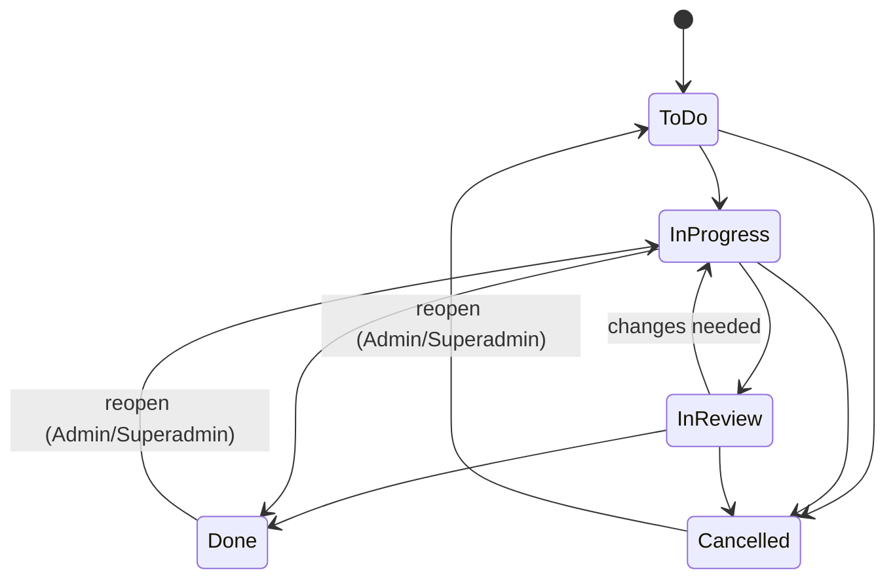
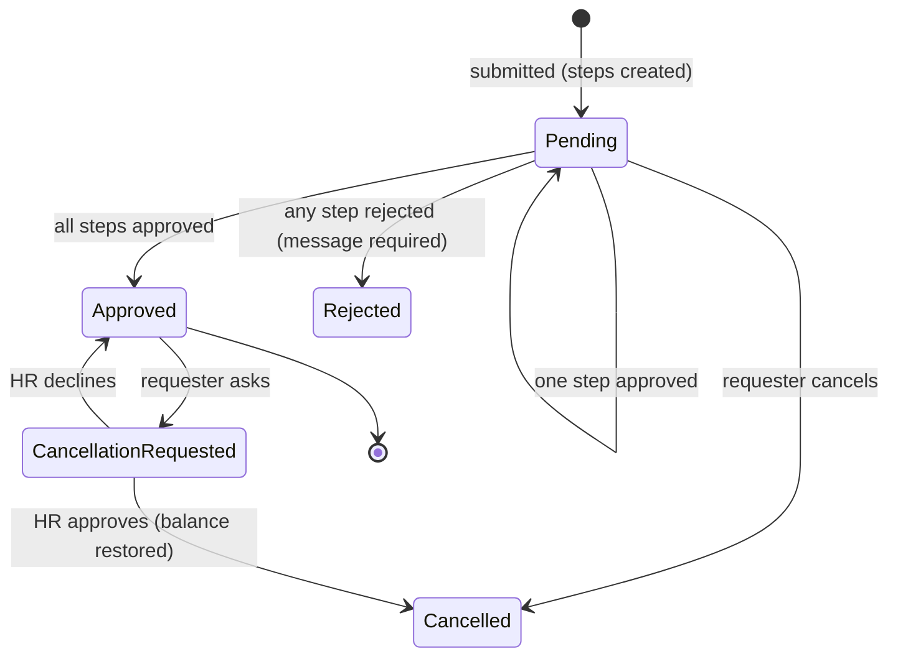
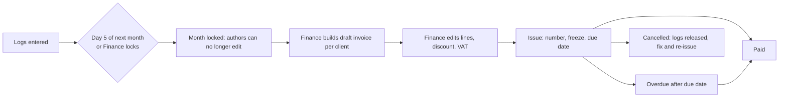

# 04. Domain analysis

Ubiquitous language: **log** = time log entry; **area** = technology area; **snapshot** = values copied onto a record at write time; **lock** = month lock; **subtree** = a manager's direct and indirect reports.

## 1. Bounded contexts (become modules, see 05)

| Context | Entities | Responsibility |
|---|---|---|
| Identity | User, Role, Permission, PersonalAccessToken, Invitation | Who you are, what you may do, onboarding, offboarding |
| Organization | Department, Country, Holiday, Skill, UserSkill | People-related reference data |
| Delivery | Area, PaymentPlan, Client, ClientAreaRate, Project, ProjectArea, Task, TaskAssignment | What work exists and its budget |
| TimeTracking | TimeLog, HourType, MonthLock | Hours worked, snapshots, locks |
| Leave | LeaveRequest, LeaveApproval, LeaveLedgerEntry | Absence and balances |
| Billing | Invoice, InvoiceLine, BillingReport (read model) | Turning logs into invoices |
| Platform | Setting, ActivityLog, Notification | Cross-cutting |
| Mcp | (no tables of its own except token scopes) | Agent-facing facade over the other contexts |

## 2. Aggregates and invariants

| Aggregate (root) | Contains | Invariants |
|---|---|---|
| **User** | Roles, UserSkills, manager link | Manager chain is acyclic. A user is not their own manager. Email unique. Deactivated user cannot authenticate. Anonymised user cannot be reactivated. |
| **Country** | Holidays, working weekdays, allowances | Holiday unique per (country, date). At least one working weekday. |
| **Client** | ClientAreaRate versions | A rate version has area, currency (the client's), amount > 0, effective_from. Rate for a given date = latest version with effective_from <= date. No two versions share the same (client, area, effective_from). |
| **Project** | ProjectArea (area + estimate minutes) | Areas must be a subset of the client's areas at selection time. |
| **Task** | TaskAssignment (many assignees) | Its area belongs to its project. Cancelled task accepts no new logs. |
| **TimeLog** (own root, high volume) | Snapshots | minutes % 15 == 0 and > 0. Task assigned to the log's user at creation. Sum per user/date <= 1440 minutes. Immutable after lock (except Admin) and after invoicing (nobody). |
| **MonthLock** | year, month | One row per month. Cannot unlock when an issued/paid invoice covers it. |
| **LeaveRequest** | LeaveApprovals | Days > 0. No overlap with another active request of the same user. Approved only when all required approvals are approved. A person is one approver at most. |
| **LeaveLedger** (append-only per user) | Entries | Balance = sum(delta) by (user, type, year). Entries are never edited or deleted, only countered. |
| **Invoice** | InvoiceLines | After Issue: lines, totals, number frozen. Number unique per year, sequential. A log belongs to at most one non-cancelled invoice. |

Cross-aggregate rules are enforced by domain services (e.g. `LogTime` action checks task assignment, lock, daily cap, rate resolution in one transaction).

## 3. Entity glossary (attributes in 06)

| Entity | Notes |
|---|---|
| User | `manager_id`, `country_id`, `department_id`, `timezone`, `is_active`, `deactivated_at`, `anonymised_at`, `start_date` |
| Country | `pto_allowance_days`, `sick_allowance_days`, `working_days` (set of ISO weekdays), `carry_over_cap_days` |
| Client | `currency`, `payment_plan_id`, `vat_percent`, `is_active` |
| ClientAreaRate | Versioned. `effective_from`, `rate_minor` (integer minor units) |
| ProjectArea | `estimate_minutes` per (project, area) |
| Task | `area_id` (must be a project area), `estimate_minutes`, `due_date`, `status` |
| HourType | `is_billable`, `client_rate_multiplier`, `is_default` |
| TimeLog | `user_id`, `task_id`, `work_date`, `minutes`, `description`, `hour_type_id`, snapshots: `area_id`, `rate_minor`, `currency`, `is_billable`, `multiplier`, `client_id`, `project_id`, `invoice_id?` |

## 4. Workflows

### 4.1 Task lifecycle



| Rule | Detail |
|---|---|
| Who | Admin/Superadmin: any transition. Assignee: To do, In progress, In review, Done (no cancel, no reopen from Cancelled). |
| Logging | Allowed in To do, In progress, In review, Done. Blocked in Cancelled. |
| Done | Does not stop logging (D-21). Budget and overdue still evaluated; overdue never shows for Done. |

### 4.2 Project lifecycle

Draft, Active, On hold, Completed, Cancelled. Logging allowed in Draft? **Assumption A-17: no**, only Active and On hold. Completed/Cancelled block tasks and logs (D-21). Reopening Completed to Active needs Admin/Superadmin.

> Note: this narrows FR-LOG-05 (Draft projects also block logging). Tasks may be prepared in Draft.

### 4.3 Time logging

```mermaid
sequenceDiagram
    participant U as Employee / MCP
    participant A as LogTime action
    participant DB as Database
    U->>A: date, task, minutes, description, hour type
    A->>DB: BEGIN, lock user's rows for that date
    A->>A: task assigned to user? task/project/client state? date <= today?
    A->>A: month locked? minutes multiple of 15?
    A->>DB: sum(minutes) for user+date; + new <= 1440?
    A->>DB: resolve rate in force on work_date for (client, task area)
    A->>DB: insert TimeLog with snapshots
    A->>DB: COMMIT
    A-->>U: saved, warnings (holiday/leave day), budget colour after save
    A->>A: dispatch BudgetCrossed event if task/project-area turned red
```

**Rate resolution:** for `(client, area, work_date)` pick the latest rate version with `effective_from <= work_date`. If none exists, the log is **rejected** (the task cannot be billed). **Assumption A-18**: rejecting is preferred over saving at zero because Finance would otherwise discover it at month end. Admin fixes by adding a rate version dated on or before the log date.

Late rate change: if Finance adds a rate version effective in the past, existing logs keep their snapshot. A "re-price logs" maintenance action (Finance, unlocked months only, audited) is **out of scope** but noted for backlog.

### 4.4 Leave approval



| Rule | Detail |
|---|---|
| Steps | Manager step (omitted if no manager) and HR step. Requester HR: HR step needs a different HR/Superadmin. Requester is a manager of themselves: no. |
| Distinct approvers | One person cannot approve two steps of the same request. |
| Negative PTO | HR step approval fails if resulting PTO < 0 unless "allow negative" ticked with a comment. Sick: never fails; flagged. |
| Ledger | On final approval: ledger entry `-days`. On approved cancellation: `+days`. Consuming order: carry-over first, then current-year allowance. |
| Cross-year request | A request spanning 31 Dec is split per year in the ledger (each year's days deducted from that year's balance). |
| Holiday/weekend | Excluded from days per the requester's country on the day of computation; **recomputed** only at approval if a holiday was added meanwhile (A-19). |
| Direct day off | HR/Superadmin creates an Approved request with `source = direct`, steps skipped, ledger entry immediately. |

### 4.5 Month lock and invoicing



### 4.6 User lifecycle

Invited (no password yet), Active, Deactivated (grace 30 days), Anonymised (terminal). Reactivation only from Deactivated.

## 5. Business rules catalogue

IDs are used by tests (11).

| ID | Rule | Source |
|---|---|---|
| BR-01 | Logs only on tasks the user is assigned to | D-21 |
| BR-02 | Hours multiple of 15 min, > 0 | D-20 |
| BR-03 | Max 24h per user per date | D-20 |
| BR-04 | No future dates | A-11 |
| BR-05 | Snapshot of area, rate (effective on work_date), currency, billable, multiplier | D-24 |
| BR-06 | No rate in force means rejection | A-18 |
| BR-07 | Author edit/delete only until month lock; Admin/Superadmin always except invoiced logs | D-25, A-03 |
| BR-08 | Locked month blocks creation by non-Admin | FR-LOCK-04 |
| BR-09 | Auto-lock on day 5 | D-25 |
| BR-10 | Unlock impossible if invoiced | FR-LOCK-03 |
| BR-11 | Project area must belong to client | D-31 context |
| BR-12 | Task area must belong to project | domain model |
| BR-13 | Rates are versioned, never edited in place | D-31 |
| BR-14 | Leave: manager and HR approve, order-free, distinct persons | D-10, D-11 |
| BR-15 | Rejection needs message | D-10 |
| BR-16 | Leave days exclude non-working days and holidays of the user's country | D-12 |
| BR-17 | PTO negative only with HR override; sick flagged | D-15 |
| BR-18 | Allowance prorated, carry-over capped, expires 31 March, consumed first | D-13/D-14 |
| BR-19 | No overlapping active leave | FR-LEAVE-03 |
| BR-20 | Colour thresholds 80/100 | D-26 |
| BR-21 | Overdue: past due and not done | D-26 |
| BR-22 | Invoice number sequential per year, assigned at issue | D-35 |
| BR-23 | Issued invoice frozen | D-35 |
| BR-24 | A log is on at most one active invoice; invoiced logs immutable | A-03 |
| BR-25 | Due date from payment plan | D-35 |
| BR-26 | Money visible only to Superadmin/Admin/Finance | D-07 |
| BR-27 | Manager chain acyclic | D-03 |
| BR-28 | Deactivation then anonymisation after 30 days | D-45 |
| BR-29 | Logging on a leave day or holiday warns but is allowed | D-16 |
| BR-30 | Project in Draft, Completed, Cancelled blocks logs; inactive client blocks logs | A-17, D-21 |

## 6. Domain events

`TimeLogged`, `TimeLogChanged`, `BudgetCrossedRed`, `MonthLocked`, `LeaveRequested`, `LeaveStepDecided`, `LeaveApproved`, `LeaveRejected`, `LeaveCancelled`, `InvoiceIssued`, `InvoiceCancelled`, `UserDeactivated`, `UserAnonymised`. Listeners are queued and live in the receiving module (notifications, audit, budget alerts).

## 7. Read models

Budget status per task and per project-area, daily hours per user, billing report, team calendar. These are computed from logs with aggregate queries (cached, see 10), not stored as authoritative data.
