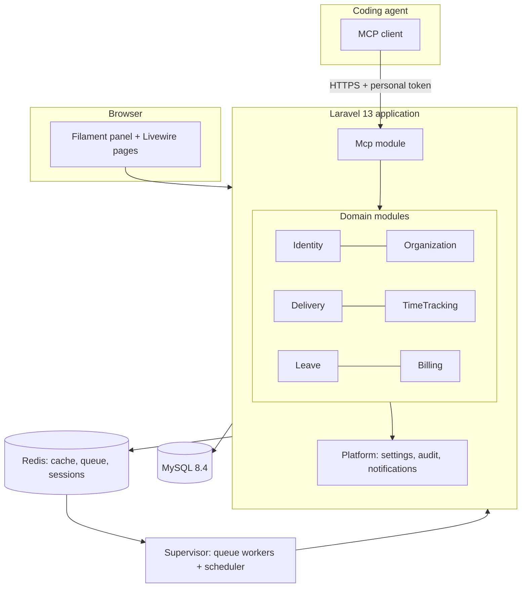
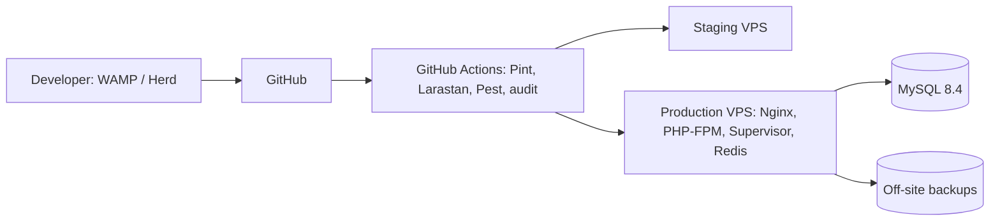

# 05. Architecture

## 1. Style: modular monolith

One Laravel application, one database, one deployable. Code is split into **modules** with explicit public surfaces. No microservices: 50-200 users and about 600 logs/day do not justify the operational cost (see 10). The only deviation from a plain Laravel layout is the module folders and architecture tests that enforce boundaries.

## 2. Version baseline (verified 2026-11-09 on Packagist)

| Component | Choice | Evidence / note |
|---|---|---|
| PHP | **8.4** (Assumption A-08) | `spatie/laravel-activitylog` 5.x requires ^8.4; `spatie/laravel-backup` 10.x README requires 8.4; Laravel 13 itself requires a lower minimum, so 8.4 is the binding constraint |
| Laravel | 13 | As specified |
| Filament | **5.x** (5.11.2 at time of writing) | `filament/support` allows `illuminate/contracts ^11.28 \| ^12.0 \| ^13.0`, PHP ^8.2. Filament 3 showed no Laravel 13 support, so it is excluded. (Filament 5 builds on Livewire 4 and Tailwind 4: confirm at install.) |
| MySQL | **8.4 LTS** | 8.0 reached end of life in 2026 (**Assumption**: confirm hosting provider offers 8.4) |
| Redis | 7+ | cache, queue, sessions |
| Node | current LTS | Vite build, Tailwind |

## 3. Package decisions

All versions are the latest stable on Packagist on 2026-11-09. "L13" = declared Laravel 13 support in `composer.json` requirements (README tables are sometimes stale).

### 3.1 Keep

| Package | Version | L13 | Use |
|---|---|---|---|
| filament/filament | 5.11 | yes | Admin and employee UI |
| spatie/laravel-permission | 8.5.0 | yes (^12 \| ^13) | Roles and permissions |
| spatie/laravel-activitylog | 5.1.4 | yes (^12 \| ^13), PHP ^8.4 | Audit trail |
| spatie/laravel-settings | 3.10.1 | yes | Typed company settings (exposed through a Filament page) |
| spatie/laravel-backup | 10.4.0 | yes (^12.40 \| ^13) | Nightly DB backup to off-site storage |
| propaganistas/laravel-phone | 6.1.0 | yes | Phone validation (E.164) |
| laravolt/avatar | 8.0.2 | yes | Local initials avatars (see 3.3) |
| stechstudio/filament-impersonate | 5.7.0 | Filament ^4 \| ^5; L13 not explicit on page, verify at install | Impersonation, wraps lab404/laravel-impersonate |
| larastan/larastan | 3.14.0 | yes | Static analysis (dev) |
| barryvdh/laravel-debugbar | 4.4.5 | yes | Dev only |
| barryvdh/laravel-ide-helper | 3.8.0 | yes | Dev only |

### 3.2 Added

| Package | Version | Why |
|---|---|---|
| laravel/mcp | 1.1.2 (L13 yes) | Official MCP server for the agent requirement (D-50) |
| laravel/sanctum | verify at install | Personal access tokens with abilities, used as MCP bearer tokens. If Sanctum does not fit, use laravel/mcp's own auth options |
| barryvdh/laravel-dompdf | 3.1.2 (L13 yes) | Invoice PDF. Chosen over headless-browser PDF to avoid a Chromium dependency on the server |
| laravel/horizon | verify at install | Queue dashboard and metrics on Redis, supervised by Supervisor. Optional: plain `queue:work` is acceptable if Horizon is not compatible |
| pestphp/pest + pest-plugin-laravel | Pest 5.3.5; plugin Laravel 13 support **not confirmed**, verify | Tests (see 11) |
| laravel/pint | with Laravel | Code style |
| sentry/sentry-laravel (**Assumption**) | verify | Error tracking |

Exports use Filament's built-in export action (queued, CSV/XLSX), so no separate Excel package.

### 3.3 Replace or drop, with reasons

| Candidate | Decision | Reason |
|---|---|---|
| creativeorange/gravatar | **Drop** | Sends email hashes to a third party; avatars are not needed for an internal tool; laravolt/avatar covers the default |
| laravolt/avatar | **Keep** | Filament's default avatar provider calls an external service (ui-avatars.com) with the user's name. A custom Filament avatar provider backed by laravolt/avatar keeps names inside the company |
| cybercog/laravel-ban (4.11.0, L13 yes) | **Drop** | Our deactivation has domain-specific life cycle (30-day grace, anonymisation, token revocation); a plain `deactivated_at` column plus a `UserDeactivated` event is simpler than a bans table |
| lab404/laravel-impersonate (1.7.8, L13 yes) | **Via filament-impersonate** | Don't wire it by hand into Filament |
| spatie/laravel-medialibrary (11.23.12) | **Drop for now** | No file attachments in the domain. Avatar and logo uploads use Filament's FileUpload on a local/S3 disk. Revisit if task attachments are requested |
| spatie/laravel-tags (4.12.0) | **Drop** | Areas and skills are structured lookups, not free tags |
| spatie/laravel-sluggable (4.0.6) | **Drop** | No public/SEO URLs; numeric or ULID ids suffice |
| spatie/laravel-comments | **Drop** | Frozen: last release 0.0.2 in 2021 and repository gone; needs Laravel 8. Task comments are not in Phase 1 scope |
| spatie/laravel-relatable | **Drop** | Not justified; not verified maintained |
| spatie/laravel-honeypot, anhskohbo/no-captcha | **Drop** | No public forms (invite-only). Login is protected by throttling and optional 2FA |
| spatie/laravel-sitemap | **Drop** | Authenticated app, nothing to index |
| spatie/laravel-cookie-consent | **Drop** | Only strictly necessary cookies (session/CSRF) are used; no tracking |
| laravel-lang/lang (15.37.7) | **Defer** (departs from your earlier "keep") | UI is English only (D-44). Packagist flags older releases as malware by a scanner (latest is not flagged). Adding it later is trivial and the framework's English strings already ship with Laravel. Reconsider with the second language |
| Translation-manager UI | **Drop** | D-44 |
| Filament Shield (4.3.1, Filament 5 yes, L13 yes) | **Do not use** | Generates per-resource CRUD permissions; our rules include relationship-based access (manager subtree) that Shield doesn't express. We hand-author the permission list (08) |

## 4. Module boundaries

Modules live in `app/Modules/<Name>` with their own models, actions, policies, events, Filament resources and a `ServiceProvider`. Allowed dependencies point **down** this list only; Platform is usable by all.

| Module | Owns | May depend on | Public surface (other modules may call) |
|---|---|---|---|
| Platform | settings, activity log config, notification base classes, shared value objects (Minutes, Money, DateRange) | none | Settings facade, `Money`, `Minutes`, base events |
| Identity | users, roles/permissions, tokens, invitations, 2FA, impersonation | Platform | `UserRepository`-style queries, `ManagerChain` service (subtree, is-manager-of) |
| Organization | departments, countries, holidays, skills | Identity, Platform | `WorkingCalendar` (is working day, holidays in range, per country) |
| Delivery | areas, payment plans, clients, rates, projects, tasks, assignments, budget read models | Identity, Organization, Platform | `RateResolver`, `TaskAccess`, `BudgetStatus` |
| TimeTracking | time logs, hour types, month locks, daily totals | Delivery, Organization, Identity, Platform | `LogTime`, `UpdateTimeLog`, `DeleteTimeLog`, `MonthLockService`, `HoursSummary` |
| Leave | requests, approvals, ledger, balances | Identity, Organization, Platform | `RequestLeave`, `DecideLeaveStep`, `LeaveBalances` |
| Billing | invoices, lines, billing report | TimeTracking, Delivery, Platform | `BuildInvoiceDraft`, `IssueInvoice` |
| Mcp | MCP server, tools, token scopes | calls only actions in other modules' public surfaces | Nothing exported |

Rules enforced by Pest architecture tests (NFR-MNT-04):

1. A module may not reference another module's Eloquent models for **writes**; it calls that module's actions.
2. Cross-module **reads** go through the public query services listed above, not ad hoc joins (the exceptions are the reporting queries in Billing, which join through documented views of log data).
3. Cross-module communication for side effects uses domain events (`TimeLogged` -> Delivery recalculates budget status/alerts; `LeaveApproved` -> TimeTracking adds calendar markers if needed).
4. Foreign keys across modules are allowed in the database (single DB), but only the owning module changes the referenced table.

## 5. Filament panel mapping

**One panel** (`app`, path `/`), per D-40. There is no separate `/admin` panel: navigation and resources appear by permission. The same UI serves an employee and a Superadmin, which avoids duplicate screens and policy drift.

### Navigation groups and visibility

| Group | Item | Implementation | Visible to (permission) |
|---|---|---|---|
| Work | Dashboard | Filament dashboard, role-aware widgets | everyone |
| Work | My tasks | Custom Livewire page | `tasks.view-own` |
| Work | Log time (quick action in top bar + page) | Livewire component | `timelogs.create-own` |
| Work | My logs | Livewire page / table | `timelogs.view-own` |
| Leave | My leave and balances | Livewire page | `leave.request-own` |
| Leave | Calendar (My / Team / Holidays) | Livewire page | everyone (Team tab by `calendar.view-team`) |
| Leave | Approvals | Filament resource (pending steps for me) | `leave.approve-as-manager` or `leave.approve-as-hr` |
| Delivery | Clients | Filament resource | `clients.view` (rates tab: `clients.view-rates`) |
| Delivery | Projects | Filament resource | `projects.view` |
| Delivery | Tasks | Filament resource | `tasks.view-any` (employees use "My tasks") |
| Team | Team logs, team balances | Filament table pages | `timelogs.view-any` / `leave.view-any` (scoped to subtree) |
| Finance | Billing report | Filament page | `reports.view-billing` |
| Finance | Invoices | Filament resource | `invoices.view` |
| Finance | Month locks | Filament page | `months.lock` |
| People | Users, Departments, Skills | Filament resources | `users.view`, lookups per `*.manage` |
| People | Countries, Holidays | Filament resources | `countries.manage`, `holidays.manage` |
| Setup | Areas, Payment plans, Hour types | Filament resources | per permission (08) |
| System | Settings, Activity log | Filament pages/resources | `settings.manage`, `activitylog.view` |
| Account | Profile, 2FA, MCP tokens | Filament profile page + Livewire | everyone |

Navigation visibility is a convenience. **Authorisation is enforced by policies and scoped queries**, never by hiding menu items.

### Where Livewire is used outside Filament resources

| Component | Reason |
|---|---|
| Quick log form (modal/top bar) | Needs optimised, stateful, keyboard-first UX not suited to a CRUD form |
| My calendar / Team calendar | Custom month grid, range-bound queries, per-day detail |
| My tasks page | Card/list view with inline status change and "log time" shortcut |
| Leave request form with live day-count and balance preview | Computes days (working week, holidays) and warns before submit |
| Set-password page (guest, outside the panel) | Invitation flow must work without authentication |
| MCP token manager | Create/revoke tokens, one-time display |

Alpine.js is used only for small client-side behaviour (hour stepper, popovers); no business rules live in the browser. Every rule is re-validated on the server by the same actions the MCP uses.

## 6. Key technical decisions

| Topic | Decision | Reason |
|---|---|---|
| Business logic location | Single-purpose **action classes** per use case (`LogTime`, `RequestLeave`, `IssueInvoice`), called by Filament, Livewire and MCP | One implementation of each rule, three entry points |
| Authorisation | spatie permissions + Laravel Policies + query scopes (`visibleTo($user)`) | Row-level subtree rules cannot be expressed by permissions alone |
| Manager subtree | Closure table **or** recursive CTE (**decision**: MySQL 8 recursive CTE, cached per request; materialised path considered if slow) | 200 users: CTE is trivial |
| Money | Integer minor units + ISO currency, never floats (`Money` value object) | Billing correctness |
| Time | Integer minutes (A-09) | Same |
| Dates | `DATE` for log/holiday/leave dates; `DATETIME` UTC for timestamps; `users.timezone` for display (A-01) | Avoid off-by-one-day bugs |
| Concurrency | Daily cap, invoice numbering and balance changes use DB transactions with row locks (`lockForUpdate`) | Correctness under concurrent writes |
| Invoice numbering | `invoice_sequences(year, last_number)` row locked during issue | Gapless sequence |
| Queues | Redis; queues: `default`, `notifications`, `exports`; Supervisor keeps workers running | Per spec |
| Scheduler | One cron entry `schedule:run`; jobs: auto-lock, annual allowance, carry-over expiry, anonymise, overdue invoices, reminders, prune | See 10 |
| Notifications | Laravel notifications: `database` (Filament) + `mail`, queued | D-43 |
| Caching | Redis; small, explicit caches (permissions, holidays per country-year, budget summaries) with event-driven invalidation | See 10 |
| Config for dev on Windows | WAMP has no native Redis: `.env.example` documents `CACHE_STORE=file`, `QUEUE_CONNECTION=sync`, `SESSION_DRIVER=file` for local; CI and staging use Redis | D-48 |
| Feature flags | None in Phase 1 | Simplicity |

## 7. Request flows

**UI log entry**: Livewire form -> `LogTime::handle(DTO)` -> validations (assignment, lock, cap, rate) -> insert -> `TimeLogged` event -> listeners: budget status refresh, activity log. The Livewire component only maps errors to fields.

**MCP log entry**: MCP tool `log_my_time` -> token authenticates user -> scope check -> **same** `LogTime` action -> structured error on failure.

**Leave approval**: Approvals resource shows only steps the viewer can decide (manager of requester or HR) -> `DecideLeaveStep` -> if all steps approved, ledger entry + `LeaveApproved` -> notifications.

## 8. Deployment topology

Single production server to start (web, workers, Redis, MySQL on the same host or managed MySQL). Everything stateless except MySQL, Redis and the storage disk, so scaling out later is possible (see 10).

## 9. Assumptions in this document

| ID | Assumption |
|---|---|
| A-20 | Filament 5 is the right major; verify by `composer require` in a throwaway project before Slice 0 |
| A-21 | Sanctum tokens are acceptable as MCP credentials; otherwise use the auth mechanism laravel/mcp documents |
| A-22 | A single production server suffices for the load in 10 |
| A-23 | Sentry (or similar) is acceptable for error tracking; no personal data is sent beyond user id |
