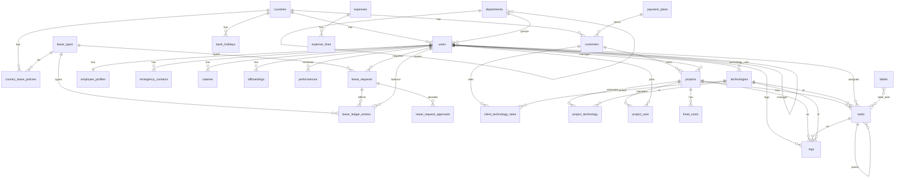

# 05 — Database design

MySQL 8.4, InnoDB, utf8mb4. Conventions from SPEC §5.0: plural snake_case tables, `{model}_id` FKs, unsigned bigint `id`, `created_at`/`updated_at` everywhere, `created_by` FK to users where the source has it, soft deletes on users, customers, projects, tasks, logs, leave_requests `[ASSUMED]`. Money: `*_minor` unsigned bigint + `currency_code` char(3). `datetime` in UTC; `date` in the country's timezone. Every FK indexed.

## 1. ERD

## 2. Tables

Columns follow SPEC §5.1–§5.6 exactly; this section lists constraints and indexes added beyond them and any `[DERIVED]` columns. No columns beyond the spec were invented.

| Table | Key constraints | Indexes |
|---|---|---|
| countries | unique `code`; `working_days` JSON/set default Mon–Fri `[DERIVED]` | — |
| country_leave_policies | unique (country_id, leave_type_id, effective_from); `days_per_year` decimal(4,1) | FK indexes |
| leave_types | unique `name`; `affects_balance` bool | — |
| bank_holidays | CHECK `end_date >= start_date` | (country_id, start_date) |
| departments | unique `slug`; self FK `parent_id` | `parent_id` |
| technologies | unique `name` | — |
| payment_plans | `type` enum (days_after_invoice, end_of_month, prepayment) | — |
| labels | unique `name` | — |
| users | unique `email`; self FK `manager_id` nullable; `anonymized_at` nullable; soft deletes; ban columns by cybercog | `manager_id`, `department_id`, `country_id` |
| employee_profiles | unique `user_id` (1:1); `phone` E.164 | — |
| emergency_contacts | FK `user_id` | `user_id` |
| technology_user | unique (user_id, technology_id); CHECK level 1–10 | FKs |
| salaries | `amount_minor` unsigned bigint; no UPDATE/DELETE by app (append-only) | (user_id, effective_date) |
| offboardings | at most one non-cancelled per user (enforced in Action + partial uniqueness via generated column `active_user_id` `[DERIVED]`) | `user_id` |
| performances | CHECK score 1–10; `review_date` `[DERIVED]` | `user_id` |
| customers | `currency_code` char(3); soft deletes; `is_active` | `country_id`, `payment_plan_id` |
| client_technology_rates | unique (customer_id, technology_id, effective_from) | FKs |
| projects | unique `slug`; `estimated_hours` decimal(10,2) and `budget_minor` computed snapshot; CHECK `end_date >= start_date`; no `priority` (D-02); soft deletes | `customer_id`, `manager_id`, `status` |
| project_technology | unique (project_id, technology_id); `estimated_hours` decimal(8,2) | FKs |
| project_user | unique (project_id, user_id) | FKs |
| fixed_costs | `date` = first of month; `currency_code` | `project_id` |
| tasks | `assignee_id` nullable; self FK `parent_id`; soft deletes | (assignee_id, status), (project_id, status) |
| label_task | unique (label_id, task_id) | FKs |
| logs | `duration_minutes` unsigned int, CHECK > 0; `task_id` nullable; `rate_minor`, `rate_currency`; soft deletes; **CHECK**: task log XOR direct log is enforced in the Action (a DB CHECK cannot reference `projects`) | (user_id, date), (project_id, date), (task_id) |
| timesheet_locks | unique `month` | — |
| leave_requests | `days_requested` decimal(4,1); soft deletes; CHECK `end_date >= start_date` | (user_id, start_date) |
| leave_request_approvals | unique (leave_request_id, stage) | FK |
| leave_ledger_entries | `days` signed decimal(4,1); append-only; unique (user_id, leave_type_id, entry_type, effective_on) **for `grant` only** via generated column, makes the annual grant idempotent `[DERIVED]` | (user_id, leave_type_id) |
| expenses `[OPTIONAL]` | unique `number` | `user_id`, `project_id` |
| expense_lines `[OPTIONAL]` | `amount_minor = quantity × unit_price_minor` | `expense_id` |
| activity_log | spatie default | spatie default |
| permission tables, settings, jobs, failed_jobs, cache | package defaults | package defaults |

Cross-table rules that MySQL cannot express (task technology ∈ project technologies; project technology ∈ client rates; manager has role admin; fixed-cost currency = client currency) are enforced in Actions and covered by tests (BR-10, BR-30, BR-14). Composite-FK enforcement is possible for the first two (`project_technology` composite key referenced from `tasks`) and is recommended: tasks reference `(project_id, technology_id)` on `project_technology` `[PROPOSED]`.

Money note (D-34): `amount_minor` is an integer in the currency's ISO 4217 minor unit. The exponent comes from a table in `App\Domain\Shared\Money` (ALL 2, EUR 2, JPY 0, KWD 3); ICU is not used because it disagrees with ISO for the lek.

M3 built as designed: tasks reference `(project_id, technology_id)` on `project_technology` (composite key, BR-10); `projects` has no priority column (D-02); `estimated_hours` and `budget_minor` are computed snapshots; `customers` and `projects` and `tasks` soft delete.

M6 built as designed: `performances` (CHECK score 1 to 10, index user and review date) and `offboardings` (generated `active_user_id` with a unique index, as proposed). Neither table soft-deletes: reviews and offboardings are never deleted.

M5 built as designed: `leave_requests` (CHECK `end_date >= start_date`, soft deletes), `leave_request_approvals` (unique per request and stage) and `leave_ledger_entries` (append-only; the generated column `idempotency_key` covers grant, carry-over and expiry entries). The unique key is `(user_id, leave_type_id, effective_on, idempotency_key)`, which is simpler than the generated date column first proposed and also protects carry-over and expiry.

M4 built as designed: `logs` (CHECK duration 1 to 1440 minutes, composite key to `project_technology`, soft deletes), `timesheet_locks` (unique month, unlock keeps the row), plus an `exports` table (type, status, filters, request context, private file path, expiry).

## 3. Access patterns

| Pattern | Query | Support |
|---|---|---|
| My Day: my pinned and assigned tasks | tasks by `assignee_id`, status not in (completed, cancelled) | (assignee_id, status) |
| Eligible direct projects | projects where flag = 1 and member | `project_user` unique pair |
| Daily total (BR-04) | SUM(duration_minutes) by user, date | (user_id, date) |
| Rate snapshot | latest rate ≤ date for (customer, technology) | unique rate index |
| Logs list/export by month | date range, project | (project_id, date), (user_id, date) |
| Leave balance | SUM(days) by user, type, not expired | (user_id, leave_type_id) |
| Overlap check (BR-23) | requests for user overlapping range, status pending/approved | (user_id, start_date) |
| Directory | users + department + technologies, public columns only | FKs |
| Estimated vs logged | SUM(logs) by project, technology | (project_id, date) |

## 4. Migration order

1. Framework defaults (users base later), cache, jobs.
2. countries, leave_types, departments, technologies, payment_plans, labels.
3. users (+ ban columns), permission tables, activity_log, settings.
4. country_leave_policies, bank_holidays.
5. employee_profiles, emergency_contacts, technology_user, salaries, offboardings, performances.
6. customers, client_technology_rates, projects, project_technology, project_user, fixed_costs.
7. tasks, label_task, logs, timesheet_locks.
8. leave_requests, leave_request_approvals, leave_ledger_entries.
9. expenses, expense_lines `[OPTIONAL]`.

Circularity: `users.country_id/department_id` need step 2 first; `projects.manager_id` needs users. Seeders (`DatabaseSeeder` order, all idempotent): permissions and roles → master data (leave types, labels, payment plans) → countries (AL, XK) → departments (Engineering with Backend/Frontend/Mobile/DevOps, plus six top-level) → technologies → superadmin user. The country, department and technology lists are starter data the owner can edit in the UI.

## Open questions for the owner

1. Soft deletes on the listed tables are `[ASSUMED]`; confirm, particularly for logs (hard delete by admin vs soft).
2. Is the composite FK for task technology acceptable, or keep it in the Action only?
3. Should `users.email` stay unique after anonymisation (placeholder is unique by id)? Default yes.
