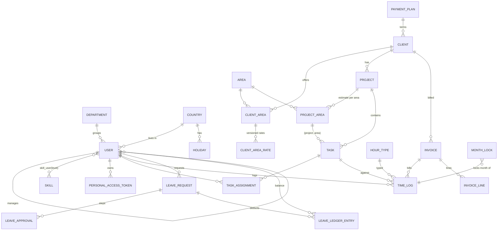

# 06. Database design

MySQL 8.4, InnoDB, `utf8mb4_0900_ai_ci`. Conventions:

- Primary keys: `BIGINT UNSIGNED` auto-increment (`id`). Single database, so no UUID need.
- Timestamps (`created_at`, `updated_at`, `*_at`) are `DATETIME` in **UTC**. Calendar dates (`work_date`, `holiday_date`, leave dates, `due_date`) are `DATE` with no timezone (A-01).
- Duration: integer **minutes** (A-09). Money: integer **minor units** (`*_minor`, e.g. cents) plus ISO 4217 `currency CHAR(3)`. Never float or decimal for money amounts. Percentages and multipliers use `DECIMAL`.
- Enumerations are `VARCHAR` with a `CHECK` constraint (or a native `ENUM`; the choice must be consistent: **decision: native PHP backed enums stored in VARCHAR(32) + CHECK**, so adding a value is a code and one-line migration change).
- Lookups are archived (`archived_at`) rather than deleted. Users are deactivated, never deleted.
- Foreign keys are real constraints, default `ON DELETE RESTRICT`.
- All tables below belong to the module shown in parentheses (see 05).

## 1. Tables

### Identity

**users**

| Column | Type | Null | Notes |
|---|---|---|---|
| id | bigint unsigned PK | | |
| name | varchar(150) | no | anonymised to `Former employee #id` |
| email | varchar(190) | no | unique; anonymised to `anonymised-<id>@invalid.local` |
| password | varchar(255) | yes | NULL until the invitation is accepted |
| password_set_at | datetime | yes | |
| can_login | boolean | no | false for staff recorded by Superadmin who have no platform access (D-17) |
| phone | varchar(32) | yes | E.164 |
| department_id | FK departments | yes | |
| country_id | FK countries | no | |
| manager_id | FK users | yes | self reference; acyclic (app + trigger-free check in action) |
| timezone | varchar(64) | no | IANA name |
| start_date | date | no | used for proration |
| end_date | date | yes | last working day |
| avatar_path | varchar(255) | yes | |
| pto_allowance_override_days | decimal(4,1) | yes | per-user override (D-13) |
| sick_allowance_override_days | decimal(4,1) | yes | |
| is_active | boolean | no | default true |
| deactivated_at | datetime | yes | starts the 30-day grace |
| anonymised_at | datetime | yes | terminal state |
| last_login_at | datetime | yes | |
| app_authentication_secret / recovery codes | text | yes | encrypted (Filament MFA columns) |
| remember_token, email_verified_at | | | standard |
| created_at, updated_at | | | |

Indexes: `UNIQUE(email)`, `(manager_id)`, `(country_id)`, `(department_id)`, `(is_active, deactivated_at)` for the anonymise job.

**user_invitations**: `id`, `user_id FK`, `token_hash char(64)`, `expires_at`, `used_at null`, `created_by FK users`, `created_at`. Index `(token_hash)`. A resend sets `expires_at = now` on previous rows.

**Spatie permission tables** (`roles`, `permissions`, `model_has_roles`, `model_has_permissions`, `role_has_permissions`): standard schema, guard `web`.

**personal_access_tokens** (Sanctum): `tokenable` (users), `name`, `token` (hash), `abilities`, `expires_at`, `last_used_at`. Index on `token` unique, `(tokenable_type, tokenable_id)`.

### Organization

| Table | Columns | Keys / constraints |
|---|---|---|
| **departments** | id, name varchar(120), archived_at | UNIQUE(name) |
| **countries** | id, iso2 char(2), name, default_timezone, pto_allowance_days decimal(4,1), sick_allowance_days decimal(4,1), carry_over_cap_days decimal(4,1) default 0, working_days_mask tinyint unsigned default 31 (Mon=1 ... Sun=64) | UNIQUE(iso2); CHECK(working_days_mask BETWEEN 1 AND 127); CHECK allowances >= 0 |
| **holidays** | id, country_id FK, holiday_date date, name varchar(150), is_half_day boolean default false | UNIQUE(country_id, holiday_date); index (holiday_date) |
| **skills** | id, name varchar(120), archived_at | UNIQUE(name) |
| **skill_user** | user_id FK, skill_id FK, level tinyint unsigned, set_by FK users, updated_at | PK(user_id, skill_id); CHECK(level BETWEEN 1 AND 10) |

### Delivery

| Table | Columns | Keys / constraints |
|---|---|---|
| **areas** | id, name, archived_at | UNIQUE(name) |
| **payment_plans** | id, name, rule varchar(32) (`prepayment`, `end_of_month`, `days_after_invoice`), days smallint null, archived_at | CHECK(rule <> 'days_after_invoice' OR days IS NOT NULL) |
| **clients** | id, name, legal_name, tax_id null, address text null, email null, currency char(3), payment_plan_id FK, vat_percent decimal(5,2) default 0, is_active, created_at, updated_at | INDEX(is_active), CHECK(vat_percent BETWEEN 0 AND 100) |
| **client_areas** | id, client_id FK, area_id FK, is_active default true | UNIQUE(client_id, area_id) |
| **client_area_rates** | id, client_area_id FK, rate_minor bigint unsigned, effective_from date, created_by FK users, created_at | UNIQUE(client_area_id, effective_from); INDEX(client_area_id, effective_from). Rows are never updated or deleted. |
| **projects** | id, client_id FK, name, description text null, status varchar(32), start_date null, end_date null, created_by FK, created_at, updated_at | INDEX(client_id, status); UNIQUE(id, client_id) (for composite FK); CHECK(end_date IS NULL OR end_date >= start_date) |
| **project_areas** | id, project_id, client_id, area_id, estimate_minutes int unsigned | UNIQUE(project_id, area_id); FK(project_id, client_id) -> projects(id, client_id); FK(client_id, area_id) -> client_areas(client_id, area_id) |
| **tasks** | id, project_id, area_id, title varchar(200), description text null, estimate_minutes int unsigned null, due_date date null, status varchar(32), created_by FK, created_at, updated_at | FK(project_id, area_id) -> project_areas(project_id, area_id); INDEX(project_id, status), INDEX(status, due_date) |
| **task_assignments** | task_id FK, user_id FK, assigned_by FK, created_at | PK(task_id, user_id); INDEX(user_id, task_id) |

The composite foreign keys enforce BR-11 (project area belongs to the client) and BR-12 (task area belongs to the project) in the database, not just in the app. Consequence: an area cannot be removed from a client while a project uses it, nor from a project while a task uses it (RESTRICT): the UI archives or reassigns instead.

```sql
-- illustrative: BR-12 enforced by the database
ALTER TABLE tasks
  ADD CONSTRAINT tasks_project_area_fk
  FOREIGN KEY (project_id, area_id) REFERENCES project_areas (project_id, area_id);
```

### TimeTracking

**hour_types**: `id`, `name` UNIQUE, `is_billable` boolean, `client_rate_multiplier` decimal(5,2) default 1.00 (CHECK > 0), `is_default` boolean, `archived_at`. A partial "exactly one default" rule is enforced in the action (MySQL has no partial unique index; use a generated column `default_flag = IF(is_default, 1, NULL)` with a UNIQUE index).

**time_logs** (largest table; about 1.5M rows in 10 years)

| Column | Type | Notes |
|---|---|---|
| id | bigint unsigned PK | |
| user_id | FK users | author |
| task_id | FK tasks | |
| project_id | FK projects | denormalised from task for reporting; never changes after write |
| client_id | FK clients | denormalised |
| area_id | FK areas | **snapshot** of the task's area at write time (D-24) |
| hour_type_id | FK hour_types | |
| work_date | date | no future dates (app rule) |
| minutes | smallint unsigned | CHECK(minutes BETWEEN 15 AND 1440 AND minutes MOD 15 = 0) |
| description | varchar(1000) | required |
| rate_minor | bigint unsigned | **snapshot**: rate in force on `work_date` |
| currency | char(3) | **snapshot** |
| multiplier | decimal(5,2) | **snapshot** of hour type |
| is_billable | boolean | **snapshot** of hour type |
| invoice_id | FK invoices null | set when included in a non-cancelled invoice |
| source | varchar(16) | `web`, `mcp`, `admin` |
| idempotency_key | varchar(64) null | MCP retries (07 section 6); UNIQUE(user_id, idempotency_key) |
| created_at, updated_at | | |

Indexes:

| Index | Serves |
|---|---|
| (user_id, work_date) | daily cap check, my logs, calendar hours per day, hours summary tool |
| (task_id) | task budget total |
| (project_id, area_id) | project-area budget |
| (client_id, work_date, project_id, area_id, hour_type_id) | billing report and invoice generation (range on client + month, grouped) |
| (work_date) | month lock checks, auto-lock sweep |
| (invoice_id) | invoice detail, release on cancel |

**month_locks**: `id`, `year` smallint, `month` tinyint, `locked_by` FK users null (null = system), `kind` (`manual`/`auto`), `locked_at`. UNIQUE(year, month). Unlock deletes the row; the deletion is written to the activity log.

### Leave

| Table | Columns | Keys / constraints |
|---|---|---|
| **leave_requests** | id, user_id FK, type (`pto`/`sick`), start_date, end_date, start_part (`full`/`am`/`pm`), end_part (same), days decimal(5,1), status (`pending`,`approved`,`rejected`,`cancelled`,`cancellation_requested`), source (`web`,`mcp`,`direct`), note text null, allow_negative boolean default false, created_by FK users, decided_at null, created_at, updated_at | INDEX(user_id, start_date, end_date), INDEX(status), INDEX(start_date, end_date) (team calendar); CHECK(end_date >= start_date) |
| **leave_approvals** | id, leave_request_id FK, step (`manager`,`hr`,`cancellation`), required_approver_id FK users null (manager step: manager at submit time; hr: null = any HR), decided_by FK users null, decision (`pending`,`approved`,`rejected`), comment text null, decided_at null | UNIQUE(leave_request_id, step); INDEX(decision, step); CHECK(decision <> 'rejected' OR comment IS NOT NULL) |
| **leave_ledger_entries** | id, user_id FK, type (`pto`,`sick`), year smallint, bucket (`allowance`,`carry_over`), delta decimal(5,1), kind (`allowance_grant`,`carry_over_grant`,`carry_over_expiry`,`deduction`,`restoration`,`adjustment`), leave_request_id FK null, comment varchar(255) null, created_by FK users null, created_at | INDEX(user_id, type, year); append-only, no `updated_at`; app DB user cannot UPDATE/DELETE (NFR-AUD-02) |

Notes:

- Half days: a single-day request uses `start_part` (`am`/`pm`/`full`) and `end_part` must equal it. For multi-day: first day `full` or `pm` (afternoon only), last day `full` or `am` (morning only).
- Balance (available) for user, type, year = `SUM(delta)`; the carry-over bucket with `year` = the year in which it is usable. Deductions are written to the carry-over bucket first, then allowance.
- Overlap prevention cannot be a DB constraint in MySQL, so `RequestLeave` locks the user row and checks overlap inside one transaction.
- If a manager changes or is deactivated while a step is pending, HR or Superadmin can reassign `required_approver_id` (**Assumption A-24**).

### Billing

| Table | Columns | Keys |
|---|---|---|
| **invoices** | id, client_id FK, number varchar(20) null, year smallint null, sequence_no int unsigned null, period_start date, period_end date, status (`draft`,`issued`,`paid`,`overdue`,`cancelled`), currency char(3), issue_date null, due_date null, paid_at null, subtotal_minor bigint, discount_type (`percent`,`amount`) null, discount_value decimal(12,2) null, discount_minor bigint default 0, vat_percent decimal(5,2), vat_minor bigint, total_minor bigint, issuer_snapshot json null, client_snapshot json null, notes text null, cancel_reason varchar(255) null, cancelled_at null, created_by FK, issued_by FK null, created_at, updated_at | UNIQUE(number); UNIQUE(year, sequence_no); INDEX(client_id, status); INDEX(status, due_date) |
| **invoice_lines** | id, invoice_id FK, position smallint, kind (`generated`,`manual`), project_id FK null, area_id FK null, hour_type_id FK null, description varchar(500), minutes int unsigned null, rate_minor bigint, multiplier decimal(5,2) default 1, amount_minor bigint | INDEX(invoice_id, position) |
| **invoice_sequences** | year smallint PK, last_number int unsigned | row locked during issue |

Number format `INV-<year>-<sequence zero-padded to 4>`. Cancelled invoices keep their numbers (no reuse).

Amount rule (A-15): `amount_minor = ROUND_HALF_UP(minutes / 60 * rate_minor * multiplier)` per **line**; invoice subtotal is the sum of lines. Never summing per-log rounded values.

### Platform and framework

`settings` (spatie/laravel-settings: group, name, payload), `activity_log` (spatie, with `batch_uuid`, `properties` JSON, plus custom `source` column and index `(subject_type, subject_id)`, `(causer_id)`, `(created_at)`), `notifications` (Laravel), `jobs`, `failed_jobs`, `job_batches`, `cache`/`cache_locks` (only if not on Redis), `exports`, `imports`, `failed_import_rows` (Filament), `sessions` (Redis in production).

## 2. ERD



(`MONTH_LOCK` relates to logs through `work_date`, not a foreign key.)

## 3. Access patterns and how the design serves them

| # | Pattern | Frequency | Query shape | Index |
|---|---|---|---|---|
| 1 | Save log: daily total for user+date | every log | `SUM(minutes) WHERE user_id=? AND work_date=?` under user-row lock | (user_id, work_date) |
| 2 | Resolve rate | every log | latest `effective_from <= work_date` for client_area | (client_area_id, effective_from) |
| 3 | My logs, month view | high | range on work_date for user | (user_id, work_date) |
| 4 | Task budget | high (task lists) | `SUM(minutes) GROUP BY task_id` for visible tasks | (task_id) ; cached (10) |
| 5 | Project-area budget | medium | `SUM GROUP BY project_id, area_id` | (project_id, area_id) |
| 6 | Billing report | monthly, heavy | client + date range, grouped by project, area, type | covering index on client |
| 7 | Team subtree | per request | recursive CTE over `manager_id` | (manager_id) |
| 8 | Team calendar | medium | leave overlapping range for set of users | (start_date, end_date), (user_id, start_date, end_date) |
| 9 | Holidays for countries in range | medium | `country_id IN (...) AND holiday_date BETWEEN` | unique (country_id, holiday_date) |
| 10 | Pending approvals for me | per page | steps where decision pending and approver is me or HR | (decision, step) |
| 11 | Leave balance | per page | `SUM(delta)` by user/type/year | (user_id, type, year) |
| 12 | Auto-lock sweep | daily | existence check in month_locks | unique (year, month) |
| 13 | Overdue invoices job | daily | `status='issued' AND due_date < today` | (status, due_date) |
| 14 | Anonymisation job | daily | `is_active=0 AND deactivated_at < now-30d AND anonymised_at IS NULL` | (is_active, deactivated_at) |

## 4. Integrity rules not expressible as constraints (enforced in actions, tested)

- Task is assigned to the user when a log is created (BR-01).
- Sum of minutes per user per day <= 1440 (BR-03): transaction plus `SELECT ... FOR UPDATE` on the user row.
- No overlapping active leave per user (BR-19).
- Month locked or invoiced logs immutable (BR-07, BR-08, BR-24).
- Manager chain acyclic (BR-27).
- Exactly one default hour type.
- Invoice frozen after issue (BR-23): the model rejects writes to issued invoices and lines; the activity log records attempts.

## 5. Data lifecycle

| Data | Retention |
|---|---|
| Logs, leave, invoices, rates | Indefinite (accounting retention about 10 years) |
| Activity log | 2 years except financial/rate events (A-16) |
| Failed jobs | 14 days |
| Notifications (read) | 90 days |
| Invitations | 30 days after expiry |
| Personal data of departed users | Anonymised 30 days after deactivation |

## 6. Migration notes

- Create tables in module order (Platform, Identity, Organization, Delivery, TimeTracking, Leave, Billing). `time_logs.invoice_id` is added after `invoices`.
- Verify CHECK constraints are enforced (MySQL 8.0.16+). They are in 8.4.
- Seed: roles and permissions, hour types, one initial Superadmin (created by artisan command, no default password in code).
