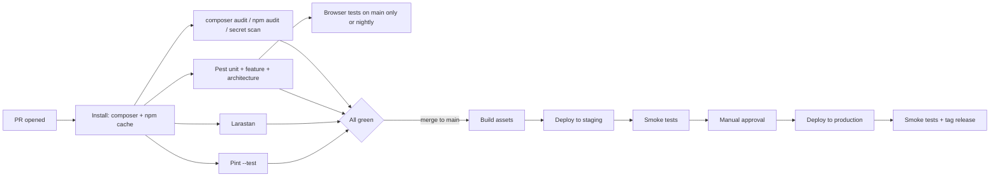

# 09. Project organization

## 1. Repository layout (modular monolith)

```
task-logger/
  app/
    Modules/
      Platform/        # settings, audit base, notifications base, value objects (Money, Minutes, DateRange)
      Identity/
      Organization/
      Delivery/
      TimeTracking/
      Leave/
      Billing/
      Mcp/
    Providers/         # app-level providers
  bootstrap/
  config/
  database/
    factories/         # shared; module factories live in modules
    seeders/
  docs/                # these design documents
  lang/                # en only; strings via __()
  public/
  resources/           # css, js (Alpine bootstrap), shared blade
  routes/              # web.php (guest invitation pages), console.php
  tests/
    Architecture/      # boundaries, policies exist, no dd()
    Feature/ Unit/ Browser/ Performance/
  .github/workflows/
```

Inside each module:

```
Modules/TimeTracking/
  Actions/             # LogTime, UpdateTimeLog, DeleteTimeLog, LockMonth ...
  DTOs/
  Enums/               # HourSource ...
  Events/ Listeners/
  Filament/            # Resources, Pages, Widgets (registered by the module provider)
  Http/Livewire/       # custom Livewire components
  Models/
  Policies/
  Queries/             # read models, scopes, reports
  Database/Migrations/ Factories/ Seeders/
  Tests/               # module-specific Pest tests (Feature/Unit)
  TimeTrackingServiceProvider.php
  README.md            # public surface and invariants of the module
```

Decision: plain folders with a service provider per module and `composer.json` PSR-4 `App\\Modules\\`. No third-party modular package (fewer moving parts); boundaries are enforced by Pest architecture tests (NFR-MNT-04).

## 2. Coding standards

| Topic | Standard |
|---|---|
| Style | PSR-12 via Laravel Pint (`laravel` preset plus `declare_strict_types`), run in CI, `pint --test` fails on diff |
| Static analysis | Larastan **level 8** (start at 6 only if needed during bootstrap and raise by 1 each sprint; never merge below the agreed level), baseline file allowed only for generated code |
| Types | `declare(strict_types=1)` everywhere, typed properties/returns, backed enums for statuses, readonly DTOs |
| Controllers/Livewire | Thin: validate, authorise, call an Action, return. No business rules in Livewire/Filament classes |
| Actions | One public `handle()` per class, wrapped in a DB transaction where multiple writes occur; throw domain exceptions, mapped to field errors (UI) or error codes (MCP) |
| Money and time | Only through `Money` and `Minutes` value objects; no floats |
| Dates | Carbon immutable; dates-only attributes cast to `Carbon` date, never converted through UTC (A-01) |
| Queries | `Model::preventLazyLoading()` outside production; no queries in Blade; scopes named `visibleTo` |
| Naming | Models singular; tables plural snake_case; actions as verbs (`RequestLeave`); events past tense (`LeaveApproved`) |
| Translations | All user-facing strings via `__()`; keys in `lang/en/<module>.php` |
| Comments | Explain **why** (rules and decisions), reference rule IDs (e.g. `// BR-03`) |
| Docs | Each module `README.md` lists its public surface; ADRs in `docs/adr/` for later decisions |
| Dev tools | ide-helper regenerated by composer script; Debugbar only in `local` |

## 3. Branching and review

| Item | Decision |
|---|---|
| Model | Trunk-based with short-lived branches: `main` always deployable |
| Branch names | `feat/<module>-<slug>`, `fix/<slug>`, `chore/<slug>` |
| Commits | Conventional Commits (`feat(leave): ...`) |
| PRs | Small (under about 400 lines), at least one review, CI green, linked to a roadmap slice (12); squash merge |
| Protection | `main` protected: required checks (Pint, Larastan, Pest, audit), no direct pushes, no force push |
| Releases | Tag `vYYYY.MM.N` on each production deploy; changelog from conventional commits |
| Hotfix | Branch from the tag, PR, tag, deploy |

## 4. Environments

| Env | Purpose | Data | Notes |
|---|---|---|---|
| local | Development: **WAMP (Windows)** and **Herd (Mac)** | Seeded fake data | Windows: no native Redis, so `.env.example` local profile uses file cache/session and `sync` queue; run Redis-dependent tests in CI. PHP 8.4 must be selected in WAMP |
| ci | GitHub Actions | Ephemeral MySQL 8.4 + Redis service containers | |
| staging | Pre-release check, load tests | Anonymised copy or synthetic data, **never** real personal data | Same stack as production |
| production | Live | Real | Linux: Nginx, PHP-FPM 8.4, MySQL 8.4, Redis, Supervisor |

Config rules: all environment differences via `.env`; `config:cache` in staging/production; separate secrets per environment; mail catch-all (Mailpit/Mailtrap) outside production.

## 5. CI/CD pipeline (GitHub Actions)



| Stage | Details |
|---|---|
| Matrix | PHP 8.4 only (baseline), MySQL 8.4, Redis 7 |
| Test DB | Real MySQL (not SQLite), because CHECK constraints, row locks and composite FKs matter |
| Browser tests | Pest browser (Playwright) nightly and on release branches |
| Deploy | Forge/Ploi or a deploy script: `composer install --no-dev -o`, `npm ci && build` in CI and upload artefact, `php artisan down` is **not** used; migrations run with `--force` (expand/contract rule below), `config:cache`, `route:cache`, `view:cache`, `filament:optimize`, `queue:restart`, Horizon terminate |
| Rollback | Redeploy previous tag; migrations are backward compatible for one release (expand then contract) |
| Smoke tests | `/up`, login page, one authenticated read via a seeded test account |
| Secrets in CI | GitHub Environments with required reviewers for production |

Migration rule (zero-downtime): additive changes first, deploy code that works with both schemas, then a later release removes the old structure. No destructive migration in the same release as the code change.

## 6. Observability and operations

| Item | Decision |
|---|---|
| Errors | Sentry (A-23) |
| Logs | JSON to stdout/file, rotated; central aggregation optional |
| Uptime | External ping on `/up`; alert on queue depth > 100, failed jobs > 0, no scheduler heartbeat in 10 min |
| Backups | `spatie/laravel-backup` nightly, 14 daily + 8 weekly + 12 monthly retained off-site, encrypted; quarterly restore drill (NFR-AV-03) |
| Supervisor | Programs: `queue-default` (2 procs), `queue-exports` (1), `horizon` or equivalent; scheduler via cron `* * * * * php artisan schedule:run` |
| Runbooks | `docs/runbooks/`: deploy, rollback, restore, rotate secrets, reset 2FA, month unlock, failed job triage |

## 7. Team workflow and definition of done

Definition of done for a slice: acceptance criteria of its FRs pass as tests; policies and role matrix tests updated; audit events present; migrations reversible or expand/contract; no Larastan/Pint failures; module README updated; deployed to staging and smoke tested.

Seed and fixtures: `DemoSeeder` builds 3 countries, 5 departments, 40 users with a manager tree, clients with versioned rates, 2 months of logs, leave requests in each state. Used locally, in staging and by performance tests (scaled up).
